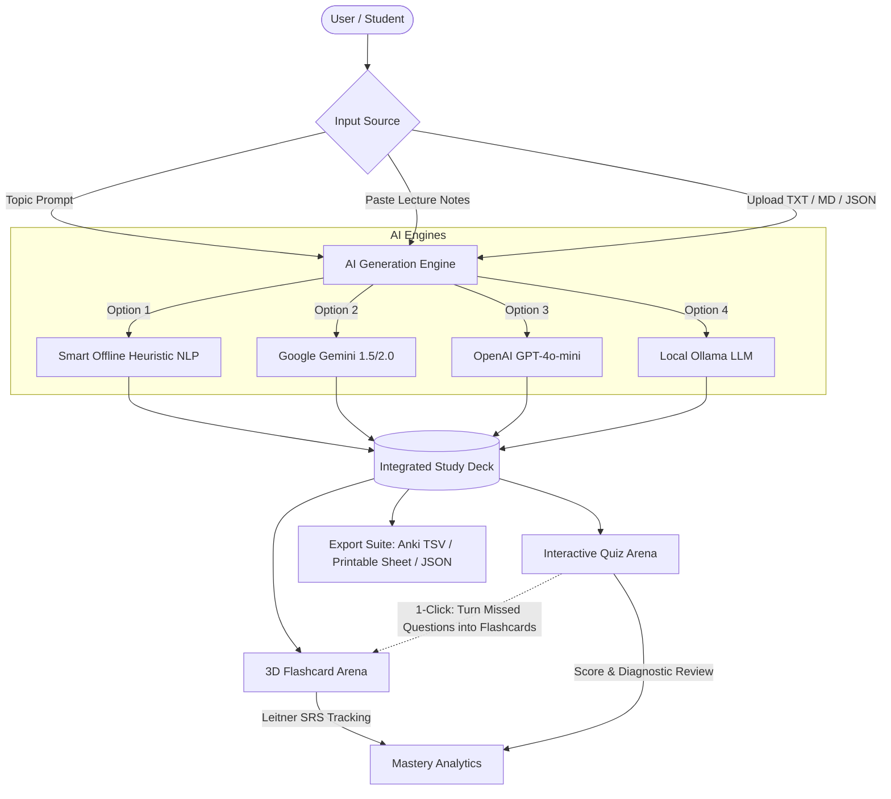

# MindSparks AI — Integrated AI Quiz & Flashcard Generator ⚡🃏

[](LICENSE)
[](https://nodejs.org/)
[]()
[]()
[]()

> An intelligent, unified study platform that turns any topic, raw lecture notes, or document into synchronized **3D Flashcards** (with Leitner Spaced Repetition) and **Interactive Quizzes** (with real-time diagnostics, timers, and automatic mistake remediation).

---

## 🌟 Highlights & Key Features

### 🔄 1. Synchronized Study Sets (The Integrated Engine)
- **Bidirectional Learning Bridge**: In traditional apps, flashcards and quizzes live in silos. In **MindSparks AI**, a study deck contains both flashcards and quizzes generated from the same source material.
- **Automatic Mistake Remediation**: When you complete a quiz, one click immediately extracts every question you answered incorrectly and converts it into focused review flashcards in your deck!

### 🧠 2. Multi-Engine AI Architecture
- **⚡ Smart Offline Heuristic Engine (Zero API Key Required)**:
  - Instant generation with 0 setup or external dependencies.
  - Extracts key terms, definitions, and relationships (`is a`, `refers to`, `consists of`, etc.).
  - Generates plausible contextual distractors for MCQs, True/False, and Cloze fill-in-the-blank tests.
  - Built-in encyclopedic knowledge domains for high-demand subjects (Data Structures, Photosynthesis, Kubernetes, Python, Machine Learning, World History, etc.).
- **✨ Google Gemini API**: High-speed, structured JSON generation powered by Gemini 1.5/2.0 Flash.
- **🤖 OpenAI API**: GPT-4o and GPT-4o-mini structured schema support.
- **🦙 Ollama / Local LLM**: Fully private, self-hosted offline inference.

### 🃏 3. 3D Flashcard Arena with Leitner Spaced Repetition (SRS)
- **Fluid 3D Card Flip**: Realistic CSS transforms and perspective animations.
- **5-Box Leitner Spaced Repetition**:
  - `Box 1`: Learning (Immediate review)
  - `Box 2`: Reviewing
  - `Box 3`: Familiar
  - `Box 4`: Proficient
  - `Box 5`: Mastered
- **Audio Text-to-Speech (TTS)**: Built-in pronunciation for terms and explanations via Web Speech API.
- **Bookmark & Star**: Flag challenging cards for targeted review.
- **Full Keyboard Navigation**: Super-fast studying without touching the mouse.

### 📝 4. Interactive Quiz Arena
- **Multiple Question Formats**: Multiple Choice (MCQ), True/False, and Fill-in-the-blank.
- **Practice vs. Exam Modes**: Instant feedback with in-depth explanations or timed exam conditions.
- **Streak Multipliers & Sound Effects**: Real-time procedural audio synthesis (Web Audio API) for correct chimes, incorrect tones, and victory fanfare.
- **Celebration Confetti**: Dynamic particle fireworks on high scores.
- **Comprehensive Diagnostic Scorecard**: Letter grades (A+, A, B, C, Needs Review), accuracy %, time taken, and answer review breakdown.

### 📊 5. Study Analytics & Mastery Dashboard
- Visualize your Leitner box progression from Box 1 to Box 5.
- Track total cards reviewed, questions answered, and daily study streaks.
- Per-deck mastery statistics.

### 📤 6. Export & Portability Suite
- **Anki TSV**: One-click export for seamless import into Anki (with tags and hints).
- **Printable Study Sheets & PDF**: Formats a clean, printable worksheet with flashcards, quiz questions, and a separate answer key.
- **Full JSON Backup & Restore**: Port your study sets across devices.

---

## 🏛️ Architecture Overview



---

## 🚀 Quick Start & Installation

### Prerequisites
- [Node.js](https://nodejs.org/) (v18.0.0 or later recommended).
- Modern web browser (Chrome, Edge, Firefox, Safari).

### 1. Clone the Repository
```bash
git clone https://github.com/aaryagupta09/ai-quiz-flashcards.git
cd ai-quiz-flashcards
```

### 2. Start the Application
Because MindSparks AI uses **native Node.js modules**, there is **no heavy npm install required**!

```bash
# Start the local server
npm start
```
Or with auto-reload:
```bash
npm run dev
```

### 3. Open in Browser
Navigate to **`http://localhost:3000`** in your browser.

> 💡 **Static Run**: You can also double-click `public/index.html` to run completely offline directly in your browser!

---

## ⌨️ Keyboard Shortcuts

| Shortcut | Context | Action |
| :--- | :--- | :--- |
| <kbd>Space</kbd> | Flashcards | Flip active flashcard |
| <kbd>→</kbd> or <kbd>D</kbd> | Flashcards | Next flashcard |
| <kbd>←</kbd> | Flashcards | Previous flashcard |
| <kbd>1</kbd> | Flashcards | Rate: **Again** (Reset to Box 1) |
| <kbd>2</kbd> | Flashcards | Rate: **Hard** |
| <kbd>3</kbd> | Flashcards | Rate: **Good** (+1 Box) |
| <kbd>4</kbd> | Flashcards | Rate: **Easy** (Mastery) |
| <kbd>S</kbd> | Flashcards | Shuffle deck |
| <kbd>A</kbd> | Flashcards | Text-to-Speech audio pronunciation |
| <kbd>F</kbd> | Flashcards | Toggle Fullscreen mode |
| <kbd>A</kbd>, <kbd>B</kbd>, <kbd>C</kbd>, <kbd>D</kbd> | Quiz Arena | Select option A, B, C, or D |

---

## ⚙️ Configuration & API Keys

MindSparks AI comes out-of-the-box with a **Smart Offline AI Engine** that works immediately without any keys.

If you wish to use Google Gemini or OpenAI:
1. Open the web app and click the **Settings** tab.
2. Enter your API key:
   - [Google Gemini API Key](https://aistudio.google.com/)
   - [OpenAI API Key](https://platform.openai.com/)
3. Click **Save Settings** (keys are saved safely in your local browser storage).

Alternatively, you can copy `.env.example` to `.env` on your server:
```bash
cp .env.example .env
```

---

## 🧪 Automated Testing

MindSparks AI includes a built-in automated test suite using the Node.js native test runner:

```bash
npm test
```

### Verified Test Cases:
- ✔ Public directory structure and required assets existence
- ✔ HTML shell and view containers integrity
- ✔ Health check endpoint JSON response (`/api/health`)
- ✔ Static file server and MIME type resolution
- ✔ Offline heuristic definition extraction & distractor generation
- ✔ Leitner 5-box Spaced Repetition SRS algorithm transitions
- ✔ Anki TSV export format compliance

---

## 📁 Project Directory Structure

```
ai-quiz-flashcards/
├── .github/
│   └── workflows/
│       ├── ci.yml            # Automated CI tests on push / PR
│       └── deploy.yml        # 1-click GitHub Pages deployment
├── public/
│   ├── css/
│   │   └── styles.css        # 3D transforms, glassmorphism & print stylesheet
│   ├── js/
│   │   ├── analytics.js      # Mastery charts & streak tracker
│   │   ├── app.js            # Main controller, navigation & theme manager
│   │   ├── audio.js          # Procedural Web Audio API sound synthesizer
│   │   ├── flashcards.js     # 3D study arena & Leitner SRS controller
│   │   ├── generator.js      # Multi-engine generator (Offline, Gemini, OpenAI)
│   │   ├── quiz.js           # Quiz arena, timer, score diagnostics & confetti
│   │   └── storage.js        # LocalStorage, starter decks & Anki/JSON export
│   └── index.html            # Main single-page application shell
├── test/
│   └── app.test.js           # Automated test suite
├── .env.example              # Environment variables template
├── .gitignore                # Git ignore rules
├── package.json              # Project metadata & npm scripts
├── server.js                 # Zero-dependency Node.js HTTP server & AI proxy
└── README.md                 # Complete documentation
```

---

## 🤝 Contributing

Contributions are always welcome!
1. Fork the repository.
2. Create your feature branch (`git checkout -b feature/AmazingFeature`).
3. Commit your changes (`git commit -m 'Add AmazingFeature'`).
4. Push to the branch (`git push origin feature/AmazingFeature`).
5. Open a Pull Request.

---

## 📄 License

This project is licensed under the **MIT License** - see the [LICENSE](LICENSE) file for details.
